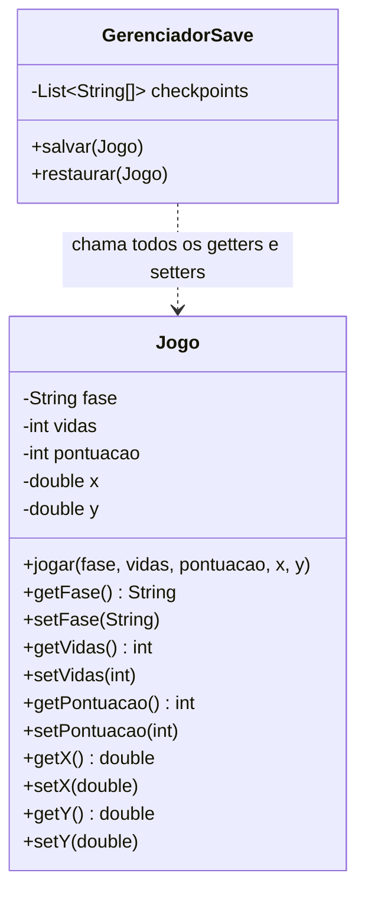
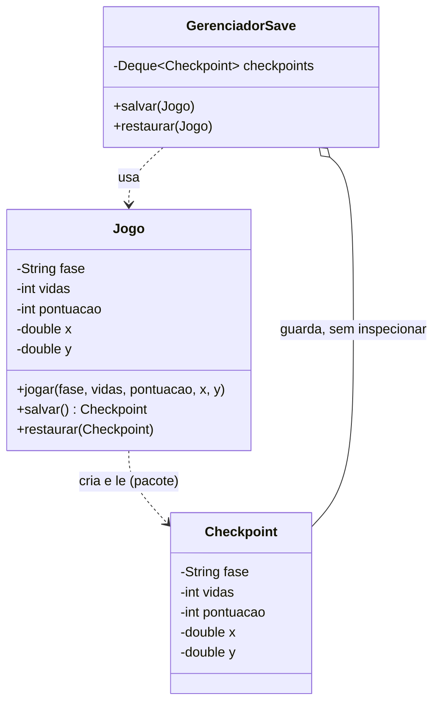

# Exercício 2 – Rastreando o anti-pattern em um projeto real

Projeto: `projeto_memento_antipattern.zip` — jogo (Maven, Java 17) com checkpoints. O código funciona, mas o estado do `Jogo` é totalmente exposto (getters/setters para tudo) e um `GerenciadorSave` externo copia os campos um a um para um `String[]`.

```bash
mvn compile
java -cp target/classes br.venson.net.designpatterns.memento.Main
```

## Código do projeto (anti-pattern)

```java
// Jogo.java
public class Jogo {

    private String fase;
    private int vidas;
    private int pontuacao;
    private double x;
    private double y;

    public void jogar(String fase, int vidas, int pontuacao, double x, double y) {
        this.fase = fase;
        this.vidas = vidas;
        this.pontuacao = pontuacao;
        this.x = x;
        this.y = y;
    }

    public String getFase() { return fase; }
    public void setFase(String fase) { this.fase = fase; }
    public int getVidas() { return vidas; }
    public void setVidas(int vidas) { this.vidas = vidas; }
    public int getPontuacao() { return pontuacao; }
    public void setPontuacao(int pontuacao) { this.pontuacao = pontuacao; }
    public double getX() { return x; }
    public void setX(double x) { this.x = x; }
    public double getY() { return y; }
    public void setY(double y) { this.y = y; }

    @Override
    public String toString() {
        return "Jogo{fase=" + fase + ", vidas=" + vidas + ", pontuacao=" + pontuacao
                + ", x=" + x + ", y=" + y + "}";
    }
}
```

```java
// GerenciadorSave.java
public class GerenciadorSave {

    private final List<String[]> checkpoints = new ArrayList<>();

    public void salvar(Jogo jogo) {
        checkpoints.add(new String[] {
                jogo.getFase(),
                String.valueOf(jogo.getVidas()),
                String.valueOf(jogo.getPontuacao()),
                String.valueOf(jogo.getX()),
                String.valueOf(jogo.getY())
        });
    }

    public void restaurar(Jogo jogo) {
        if (checkpoints.isEmpty()) {
            System.out.println("Nenhum checkpoint salvo.");
            return;
        }
        String[] c = checkpoints.remove(checkpoints.size() - 1);
        jogo.setFase(c[0]);
        jogo.setVidas(Integer.parseInt(c[1]));
        jogo.setPontuacao(Integer.parseInt(c[2]));
        jogo.setX(Double.parseDouble(c[3]));
        jogo.setY(Double.parseDouble(c[4]));
    }
}
```

## Perguntas

**1.** O `Jogo` expõe getters e setters para todos os atributos. Por que isso quebra o encapsulamento? Que riscos isso traz para a consistência do estado?

*Resposta:*
O Jogo vira uma classe anêmica: qualquer código externo pode ler e, principalmente, escrever em qualquer campo a qualquer momento, inclusive em combinações inválidas, por exemplo setVidas(-5) sem passar por jogar(). Isso quebra o encapsulamento porque quem garante o estado válido deixa de ser o Jogo e passa a ser qualquer chamador externo, como o GerenciadorSave, que manipula os campos um a um.

---

**2.** O `GerenciadorSave` monta um `String[]` com os campos, na ordem, e os converte de volta. Se o `Jogo` ganhar um novo atributo (ex.: `inimigos`), quantos pontos precisam ser alterados? O que isso indica sobre o acoplamento?

*Resposta:*
Pelo menos três pontos: o método salvar do GerenciadorSave, para adicionar o campo novo no array, o método restaurar, para fazer o parse de volta na posição certa, e qualquer lugar que dependa da posição ou tamanho do array. Isso indica acoplamento forte: o GerenciadorSave conhece a estrutura interna exata do Jogo, ordem e tipo de cada campo, quando deveria só guardar e devolver o que o Jogo já soubesse empacotar.

---

**3.** O "snapshot" vira uma lista de `String[]`. Quais são as consequências de perder o tipo do estado (ordem, conversões, erros silenciosos)?

*Resposta:*
Perde a verificação do compilador: a ordem dos campos no array é uma convenção que só existe na cabeça de quem escreveu o código, então trocar a ordem ou esquecer um campo não dá erro de compilação, só comportamento errado em runtime. As conversões, Integer.parseInt e Double.parseDouble, podem lançar exceção se o formato mudar, e um checkpoint corrompido ou incompleto falha silenciosamente até ser usado.

---

**4.** Proponha uma refatoração com o padrão Memento, deixando explícitos:
- o memento (`Checkpoint`), imutável;
- o originator (`Jogo`), que cria (`salvar()`) e restaura (`restaurar(...)`);
- o caretaker (`GerenciadorSave`), que guarda os mementos sem inspecioná-los;
- a diferença entre a interface estreita (caretaker) e a ampla (originator).

*Resposta:*
Checkpoint vira uma classe imutável, só com acesso de pacote, sem setters, guardando fase, vidas, pontuacao, x e y. O Jogo passa a ser o originator: ganha um método salvar que cria um Checkpoint com o próprio estado atual, e um método restaurar que aplica os valores de volta, e só o Jogo sabe montar ou ler um Checkpoint, porque estão no mesmo pacote. O GerenciadorSave vira o caretaker: guarda uma pilha de Checkpoint sem nunca chamar getters neles, só empilha e desempilha. A interface estreita é o que o caretaker vê de fora, um Checkpoint como objeto opaco, a interface ampla é o que o Jogo usa internamente para ler e montar o Checkpoint.

---

**5.** Depois de refatorar, como adicionar um novo atributo ao jogo deixa de mexer no caretaker? E como o histórico fica tipado e seguro?

*Resposta:*
Um atributo novo só exige mudar o Checkpoint e os métodos salvar e restaurar do Jogo, o GerenciadorSave continua igual, porque ele nunca conheceu os campos, só guarda objetos Checkpoint. O histórico fica tipado porque é uma coleção de Checkpoint, não de String array, então o compilador garante que só se guarda e devolve o tipo certo, sem parse manual nem risco de errar a ordem.

---

## Entrega

### Diagrama de classes — antes



### Diagrama de classes — depois



### Código refatorado

```java
// Checkpoint.java — o memento: imutável, acesso restrito ao pacote
package br.venson.net.designpatterns.memento;

public final class Checkpoint {

    private final String fase;
    private final int vidas;
    private final int pontuacao;
    private final double x;
    private final double y;

    Checkpoint(String fase, int vidas, int pontuacao, double x, double y) {
        this.fase = fase;
        this.vidas = vidas;
        this.pontuacao = pontuacao;
        this.x = x;
        this.y = y;
    }

    String getFase() {
        return fase;
    }

    int getVidas() {
        return vidas;
    }

    int getPontuacao() {
        return pontuacao;
    }

    double getX() {
        return x;
    }

    double getY() {
        return y;
    }
}
```

```java
// Jogo.java — o originator: cria e restaura o próprio estado
package br.venson.net.designpatterns.memento;

public class Jogo {

    private String fase;
    private int vidas;
    private int pontuacao;
    private double x;
    private double y;

    public void jogar(String fase, int vidas, int pontuacao, double x, double y) {
        this.fase = fase;
        this.vidas = vidas;
        this.pontuacao = pontuacao;
        this.x = x;
        this.y = y;
    }

    public Checkpoint salvar() {
        return new Checkpoint(fase, vidas, pontuacao, x, y);
    }

    public void restaurar(Checkpoint checkpoint) {
        this.fase = checkpoint.getFase();
        this.vidas = checkpoint.getVidas();
        this.pontuacao = checkpoint.getPontuacao();
        this.x = checkpoint.getX();
        this.y = checkpoint.getY();
    }

    @Override
    public String toString() {
        return "Jogo{fase=" + fase + ", vidas=" + vidas + ", pontuacao=" + pontuacao
                + ", x=" + x + ", y=" + y + "}";
    }
}
```

```java
// GerenciadorSave.java — o caretaker: guarda mementos sem inspecionar
package br.venson.net.designpatterns.memento;

import java.util.ArrayDeque;
import java.util.Deque;

public class GerenciadorSave {

    private final Deque<Checkpoint> checkpoints = new ArrayDeque<>();

    public void salvar(Jogo jogo) {
        checkpoints.push(jogo.salvar());
    }

    public void restaurar(Jogo jogo) {
        if (checkpoints.isEmpty()) {
            System.out.println("Nenhum checkpoint salvo.");
            return;
        }
        jogo.restaurar(checkpoints.pop());
    }
}
```

```java
// Main.java
package br.venson.net.designpatterns.memento;

public class Main {

    public static void main(String[] args) {
        Jogo jogo = new Jogo();
        GerenciadorSave save = new GerenciadorSave();

        jogo.jogar("Fase 1", 3, 100, 10.0, 20.0);
        save.salvar(jogo);
        System.out.println("Apos salvar:      " + jogo);

        jogo.jogar("Fase 2", 1, 450, 80.0, 15.0);
        System.out.println("Depois de jogar:  " + jogo);

        save.restaurar(jogo);
        System.out.println("Apos restaurar:   " + jogo);
    }
}
```

### Justificativa das decisões de design

O Checkpoint ficou imutável e com acesso de pacote porque um memento não deveria poder ser alterado depois de criado nem lido por quem não seja o próprio originator — isso impede qualquer caretaker de inspecionar ou corromper o estado salvo. O Jogo concentrou em si os métodos salvar e restaurar porque só ele conhece as regras do próprio estado, eliminando os getters/setters públicos que existiam antes. O GerenciadorSave trocou a lista de String array por uma pilha de Checkpoint porque assim ele nunca mais precisa saber quantos campos o Jogo tem nem a ordem deles: ele só empilha e desempilha objetos opacos, então um atributo novo no Jogo não exige nenhuma mudança no caretaker.
