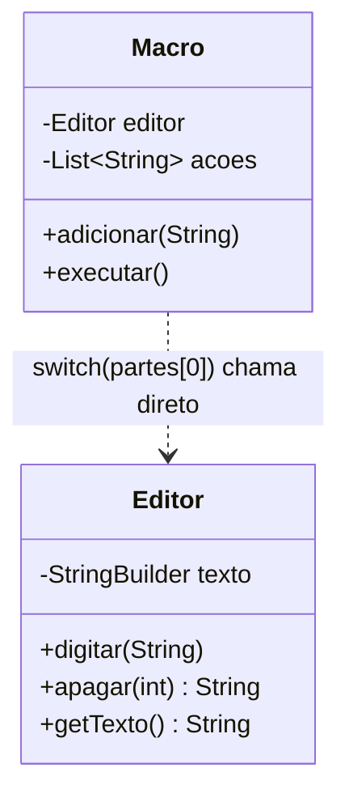
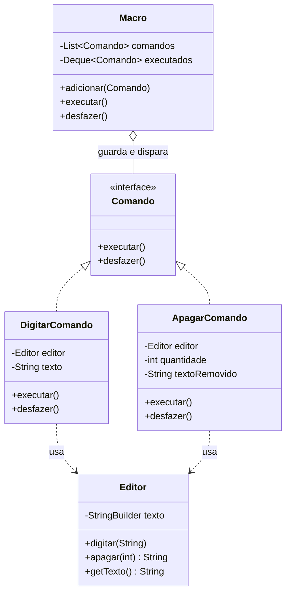

# Exercício 2 – Rastreando o anti-pattern em um projeto real

Projeto: `projeto_command_antipattern.zip` — editor de texto (Maven, Java 17) com macros. O código funciona, mas a macro é uma lista de strings interpretada por um `switch` dentro do invocador, que conhece cada operação e não sabe desfazer nada.

```bash
mvn compile
java -cp target/classes br.venson.net.designpatterns.command.Main
```

## Código do projeto (anti-pattern)

```java
// Editor.java
public class Editor {

    private final StringBuilder texto = new StringBuilder();

    public void digitar(String t) {
        texto.append(t);
    }

    public String apagar(int n) {
        int inicio = texto.length() - n;
        String removido = texto.substring(inicio);
        texto.delete(inicio, texto.length());
        return removido;
    }

    public String getTexto() {
        return texto.toString();
    }
}
```

```java
// Macro.java
public class Macro {

    private final Editor editor;
    private final List<String> acoes = new ArrayList<>();

    public Macro(Editor editor) {
        this.editor = editor;
    }

    public void adicionar(String acao) {
        acoes.add(acao);
    }

    public void executar() {
        for (String a : acoes) {
            String[] partes = a.split(":");
            switch (partes[0]) {
                case "DIGITAR" -> editor.digitar(partes[1]);
                case "APAGAR" -> editor.apagar(Integer.parseInt(partes[1]));
                default -> throw new IllegalArgumentException("Acao invalida: " + a);
            }
        }
    }
}
```

## Perguntas

**1.** A `Macro` decide a ação com `switch (partes[0])` e chama o `Editor` diretamente. Por que isso é um acoplamento forte entre o invocador e as operações? O que acontece ao adicionar a ação `SUBSTITUIR`?

*Resposta:*
A Macro, o invocador, conhece cada operação possível e decide como executá-la, além de depender diretamente da API do Editor, o receiver. Isso é acoplamento forte porque o invocador deveria só disparar uma ação, não saber como ela é feita. Para adicionar SUBSTITUIR, seria preciso alterar o próprio switch da Macro, um novo case, ou seja, a classe que dispara comandos muda toda vez que surge uma operação nova, ela não está fechada para modificação.

---

**2.** As ações são strings como `"DIGITAR:Ola"`. Quais problemas de tipo e validação isso traz? O que acontece se o parâmetro vier no formato errado?

*Resposta:*
Os parâmetros ficam sem tipo, tudo é texto, então erros só aparecem em runtime: um APAGAR com letras quebraria no Integer.parseInt, e um DIGITAR sem o separador lançaria ArrayIndexOutOfBoundsException ao acessar partes[1]. Não existe validação de formato nem checagem do compilador, qualquer erro de digitação na string vira exceção em tempo de execução, difícil de prever lendo o código.

---

**3.** Ao rodar o `Main`, por que não é possível desfazer a macro? O que faltaria para reverter cada passo executado?

*Resposta:*
Não dá para desfazer porque nada guarda o que foi feito em cada passo, a Macro só chama editor.digitar ou editor.apagar e esquece. Faltaria, para cada ação executada, guardar o suficiente para reverter, por exemplo o texto digitado para poder apagar o mesmo tanto, ou o texto apagado para poder digitar de volta, e algum jeito de percorrer essas ações executadas em ordem reversa.

---

**4.** Proponha uma refatoração com o padrão Command, deixando explícitos:
- a interface de comando (`Comando`, com `executar()` e `desfazer()`);
- os comandos concretos (`DigitarComando`, `ApagarComando`);
- o receiver (`Editor`), que faz o trabalho real;
- o invoker (`Macro`), que apenas guarda e dispara comandos.

*Resposta:*
Comando vira uma interface com executar e desfazer. DigitarComando guarda o Editor e o texto a digitar: executar chama editor.digitar, desfazer chama editor.apagar com o tamanho do texto. ApagarComando guarda o Editor e a quantidade: executar chama editor.apagar e guarda o texto removido, desfazer chama editor.digitar com o texto removido. O Editor continua sendo o receiver, com a lógica real de digitar e apagar, ele nem sabe que existe Comando. A Macro vira o invoker: só guarda uma lista de Comando e, ao executar, empilha cada um numa pilha de executados; desfazer desempilha e chama desfazer em cada um, sem saber o que cada comando faz por dentro.

---

**5.** Depois de refatorar, como adicionar uma ação nova fica mais simples? E de que forma o mesmo comando passa a permitir enfileirar, agendar e desfazer?

*Resposta:*
Uma ação nova vira só uma classe nova implementando Comando, a Macro não muda nada, porque ela só conhece a interface. E como cada ação agora é um objeto com executar e desfazer, o mesmo comando pode ser guardado numa fila para rodar depois, reordenado, ou desfeito individualmente, porque ele carrega tudo que precisa para isso, sem depender de estar sendo processado num switch específico.

---

## Entrega

### Diagrama de classes — antes



### Diagrama de classes — depois



### Código refatorado

```java
// Comando.java — a interface de comando
package br.venson.net.designpatterns.command;

public interface Comando {
    void executar();
    void desfazer();
}
```

```java
// Editor.java — o receiver, sem mudanças na lógica real
package br.venson.net.designpatterns.command;

public class Editor {

    private final StringBuilder texto = new StringBuilder();

    public void digitar(String t) {
        texto.append(t);
    }

    public String apagar(int n) {
        int inicio = texto.length() - n;
        String removido = texto.substring(inicio);
        texto.delete(inicio, texto.length());
        return removido;
    }

    public String getTexto() {
        return texto.toString();
    }
}
```

```java
// DigitarComando.java
package br.venson.net.designpatterns.command;

public class DigitarComando implements Comando {

    private final Editor editor;
    private final String texto;

    public DigitarComando(Editor editor, String texto) {
        this.editor = editor;
        this.texto = texto;
    }

    @Override
    public void executar() {
        editor.digitar(texto);
    }

    @Override
    public void desfazer() {
        editor.apagar(texto.length());
    }
}
```

```java
// ApagarComando.java
package br.venson.net.designpatterns.command;

public class ApagarComando implements Comando {

    private final Editor editor;
    private final int quantidade;
    private String textoRemovido;

    public ApagarComando(Editor editor, int quantidade) {
        this.editor = editor;
        this.quantidade = quantidade;
    }

    @Override
    public void executar() {
        textoRemovido = editor.apagar(quantidade);
    }

    @Override
    public void desfazer() {
        editor.digitar(textoRemovido);
    }
}
```

```java
// Macro.java — o invoker
package br.venson.net.designpatterns.command;

import java.util.ArrayDeque;
import java.util.ArrayList;
import java.util.Deque;
import java.util.List;

public class Macro {

    private final List<Comando> comandos = new ArrayList<>();
    private final Deque<Comando> executados = new ArrayDeque<>();

    public void adicionar(Comando comando) {
        comandos.add(comando);
    }

    public void executar() {
        for (Comando comando : comandos) {
            comando.executar();
            executados.push(comando);
        }
    }

    public void desfazer() {
        while (!executados.isEmpty()) {
            executados.pop().desfazer();
        }
    }
}
```

```java
// Main.java
package br.venson.net.designpatterns.command;

public class Main {

    public static void main(String[] args) {
        Editor editor = new Editor();
        Macro macro = new Macro();

        macro.adicionar(new DigitarComando(editor, "Ola "));
        macro.adicionar(new DigitarComando(editor, "mundo"));
        macro.adicionar(new ApagarComando(editor, 3));

        macro.executar();
        System.out.println("Texto: \"" + editor.getTexto() + "\"");

        macro.desfazer();
        System.out.println("Apos desfazer: \"" + editor.getTexto() + "\"");
    }
}
```

### Justificativa das decisões de design

A interface Comando ficou só com executar e desfazer porque é o contrato mínimo que qualquer ação do editor precisa cumprir, sem expor nada da implementação de cada ação. DigitarComando e ApagarComando guardam exatamente o que precisam para reverter a própria ação, o tamanho do texto digitado ou o texto que foi apagado, porque quem sabe desfazer uma ação é a própria ação, não quem a disparou. O Editor não mudou porque ele é o receiver, a lógica de negócio real não tem nada a ver com o padrão em si. A Macro perdeu o switch e virou só um invoker genérico, guardando uma pilha de comandos já executados, o que é o que permite o desfazer em sequência reversa sem conhecer o que cada comando faz.
